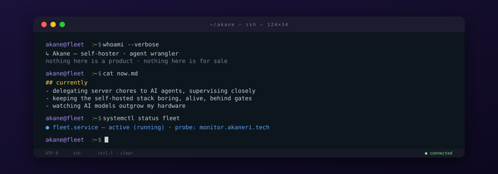

  

### the fleet

A handful of VPS runs the things I actually use — photos, feeds, dashboards — so my data isn't a feature of someone else's product.

Immich · Miniflux · Beszel · Arcane · Open WebUI — the usual suspects. Their heartbeat lives on the [probe](https://monitor.akaneri.tech); the rest of the fleet stays behind the gate.

### into

- zero-trust networking — every door locked, one key per human
- the unglamorous craft: backups, uptime, dashboards that tell the truth
- systemd timers, and the quiet confidence of cron

### off the clock

listening — [日向文](https://www.hinataya.me/) · [羊文学](https://www.hitsujibungaku.info/)

reading — Japanese mystery novels · WeChat Read annual member

playing — Overwatch

watching — anime, seasonally

---

*written and deployed by an agent, reviewed by a human*
